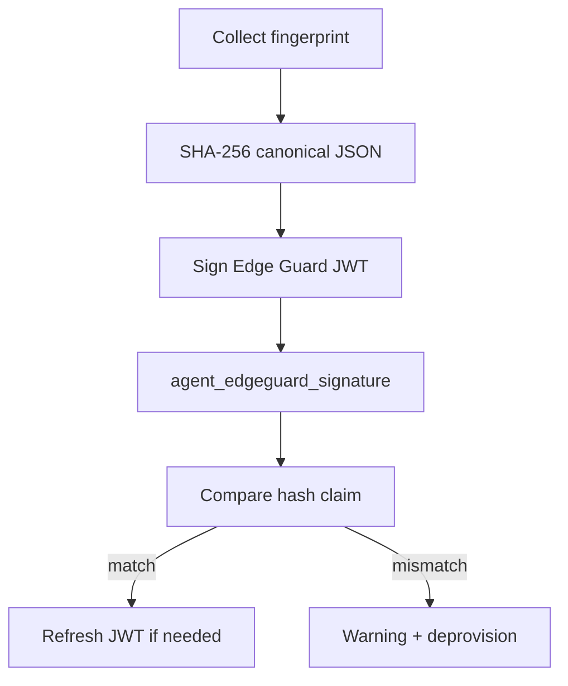

# Edge Guard (runtime module)

Edge Guard is the daemon **hardware attestation loop**. It fingerprints the host, signs a baseline JWT, stores it in SQLite, and on fingerprint drift triggers controller warning + agent deprovision.

**Code:** `internal/edgeguard/`

**Operator guide:** [../edgeguard.md](../edgeguard.md) (configuration, fingerprint sources, mismatch behavior)

## Purpose

- Periodic hardware fingerprint collection (platform-specific)
- Sign stable `hash` claim into Edge Guard JWT
- Compare new fingerprint hash to stored baseline (not full JWT string)
- POST warning + deprovision on real hardware change
- Disable cleanly when `edgeGuardFrequency=0`

## Dependencies

| Depends on | Reason |
|------------|--------|
| `auth` | `GenerateEdgeGuardJWT`, `EdgeGuardHashFromJWT()` |
| `store` | `agent_edgeguard_signature` singleton row |
| `config` | `edgeGuardFrequency`, `iofogUuid`, private key |
| `fieldagent` | Deprovision + status POST on mismatch |
| `statusreporter` | Warning message on supervisor status |

| Used by | Reason |
|---------|--------|
| `supervisor` | Started last in module sequence |

## Lifecycle

### Start

`(*Manager).Start()`:

1. If unprovisioned or no private key → force frequency to 0, delete stored signature if disabled
2. If frequency ≤ 0 → no-op (disabled)
3. Load signature cache from DB
4. Run initial `checkHardwareSignature()`
5. Start `attestationWorker` ticker at `edgeGuardFrequency` seconds

### Stop

Cancel attestation context; stop ticker.

### Config update

`InstanceConfigUpdated()` reschedules attestation interval; cancels prior worker goroutine to avoid leaks.

## Attestation flow

Comparison uses `auth.EdgeGuardHashFromJWT()` on the stored JWT vs newly computed hash — avoids false deprovision when only `iat`/`exp`/`jti` rotate.

## What counts as a hardware change

A hardware change is a difference in the identity fingerprint. Edge Guard lowercases and trims strings, sorts device lists, then SHA-256 hashes that JSON. The stored Edge Guard JWT is compared by its `hash` claim. A new JWT whose only changes are `iat`, `exp`, or `jti` is not a hardware change.

The identity hash does not include NIC link state or the TPM PCR file. Link state is stored separately as a `links` claim on the same JWT and is the lock taken when the baseline was stored. A stored JWT with no `links` claim is re-baselined on the next check and does not deprovision.

An identity-hash mismatch, a new or removed MAC, a USB change, or a locked-down port becoming up sets daemon status to `WARNING`, sets `warningMessage` to `HW signature changed` (20 characters), `PUT`s that status to the controller, then deprovisions. `securityViolationInfo` is not sent by Edgelet. The controller builds that field from the warning.

### Fields that change the hash

| Field | Hashed values | A change means |
|---|---|---|
| System | Product UUID, serial, vendor, model | Board identity or a VM move |
| BIOS | Vendor, version | Firmware change |
| Motherboard | Product, serial | Board swap |
| CPU | Vendor, model name, family, model, stepping, physical core count | CPU identity change. Load and frequency are not included. |
| PCI | Slot, class, vendor, device, subsystem vendor, subsystem device | Card added, removed, or moved to another slot |
| GPU | Derived from PCI class `0x03` | Follows the PCI list |
| Root disk | Device path, serial, WWN, model | Root disk replaced or the root device path changed |
| NICs | Name and MAC. Link state is the separate lock below. | Adapter added or removed |
| USB | Bus path, vendor, product, manufacturer, product name, serial | Plug, unplug, or a different port. USB hubs are skipped. |
| Optional | Memory-module locator, serial, part number; secure boot; TPM present and EK hash; board serial; `/etc/machine-id` | DIMM, secure-boot, TPM identity, or machine-id change. The PCR file hash is not part of the identity hash. |
| ARM only | Device-tree model, compatible, serial | Board identity on arm and arm64 |

Empty DMI placeholders (`none`, `not specified`, `not available`, `unknown`, `to be filled by o.e.m.`) are omitted before hashing.

### NIC link state

Linux link state is `/sys/class/net/<iface>/carrier`. Edge Guard stores one of three values:

| Value | Meaning |
|---|---|
| `1` | Interface is administratively up and the PHY has carrier |
| `0` | Interface is administratively up and the PHY has no carrier |
| `unknown` | `carrier` could not be read, which is what Linux returns when the interface is administratively down |

IP addresses, routes, and whether packets flow are not part of the fingerprint.

Included interfaces are those with a real MAC whose names start with `eth`, `en`, `em`, `eno`, `ens`, `enp`, `wlan`, `wlp`, or `wwan`. That includes USB Ethernet names such as `enx*`. Ignored names start with `lo`, `docker`, `br-`, `veth`, `virbr`, `tun`, `tap`, `vmnet`, `vnet`, `cni`, `flannel`, or `cali`.

The lock is the link state stored when the baseline was taken. It is not rewritten when carrier drops, so the link coming back is not a new cable.

| Locked state | Live state | Result |
|---|---|---|
| `0` or `unknown` | `1` | Deprovision |
| `1` | `0` or `unknown` | Local log only. The node stays provisioned. |
| `0` | `unknown`, or the reverse | No deprovision |
| any | same | No deprovision |

A downward change is logged once per transition for the life of the process. It does not set `warningMessage` and does not `POST` status. A restart may log one more line if the link is still down.

**Ethernet cabled to a modem.** A direct cable into a modem that is powered off moves a locked-up port from `1` to `0` or `unknown` while the host interface stays in the baseline. The node stays provisioned. A switch left powered between the host and the modem keeps the host link up, so shutting the modem down does not change `linkState`. Plugging a cable into a port that was locked down (`0` or `unknown` to `1`) deprovisions.

**USB modem.** The hashed identity is the adapter name and MAC, not the cellular session inside the modem. Unplugging the stick removes that NIC and deprovisions. Losing cellular data while the stick stays plugged in and enumerated leaves the MAC in place. If that port was locked up, carrier loss only logs. If it was locked down, carrier becoming `1` deprovisions.

**Wi-Fi (`wlp*`, `wlan*`).** Losing association normally moves carrier from `1` to `0` or `unknown` and does not deprovision when the port was locked up. Staying associated while only the upstream path dies leaves `linkState` at `1`.

**WWAN (`wwan*`).** A session drop that only changes carrier on an already locked-up interface does not deprovision. The interface disappearing, or a locked-down interface becoming `1`, does.

## Configuration

| Key | Effect |
|-----|--------|
| `edgeGuardFrequency` | Interval seconds; **0 disables** |
| `iofogUuid` | Must be set (provisioned) for attestation to run |

Unprovisioned agents force frequency to 0 at Field Agent and Edge Guard start.

## Data and persistence

| Table | Content |
|-------|---------|
| `agent_edgeguard_signature` | Latest attestation JWT (`id=1`) |

On disable, signature row is deleted.

## External APIs

No direct HTTP. Side effects:

- Field Agent deprovision path
- Controller status POST with warning
- Clears supervisor warning after successful re-provision (Field Agent)

## Observability

- Log module name: `"Edge Guard Manager"`
- Not in `modulesStatus[]` fixed array; warning via `SupervisorStatus.warningMessage`

## Failure modes

| Symptom | Typical cause |
|---------|----------------|
| Unexpected deprovision | Hardware change; locked-down port becoming up; USB plug or unplug; new or removed NIC; VM migration; fingerprint source drift |
| Attestation skipped | Frequency 0 or unprovisioned |
| Start error | DB signature load failure on enabled config |

Platform fingerprint collection: `fingerprint_linux.go`, `fingerprint_darwin.go`, etc.

## Code map

| File | Role |
|------|------|
| `manager.go` | Start/stop, attestation worker, deprovision trigger |
| `fingerprint_*.go` | Platform fingerprint collectors |
| `fingerprint_types.go`, `fingerprint_diff.go` | Canonical payload + diff |

Related: [auth.md](auth.md), [fieldagent.md](fieldagent.md), [store.md](store.md), [../edgeguard.md](../edgeguard.md).
